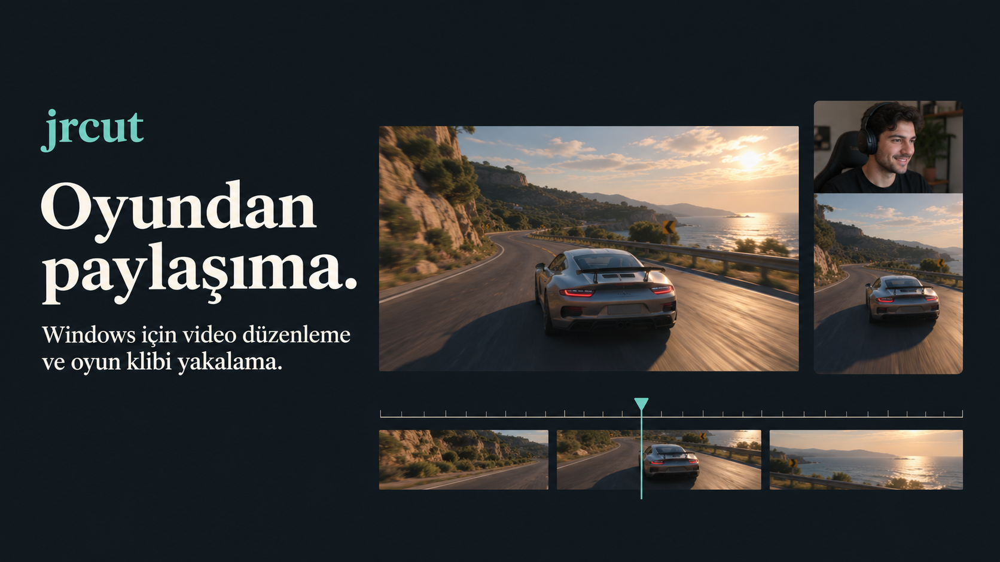
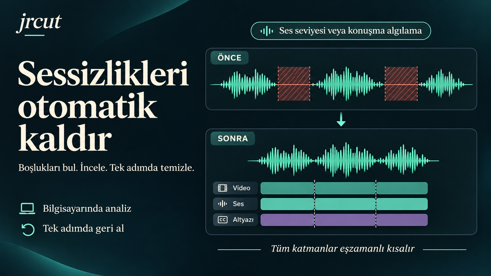
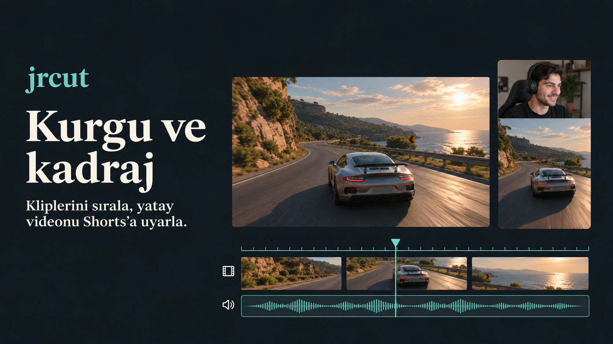
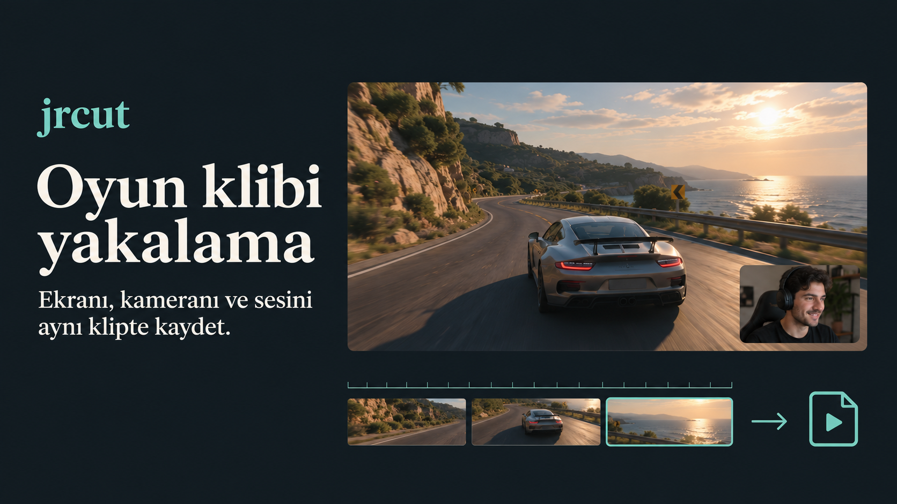
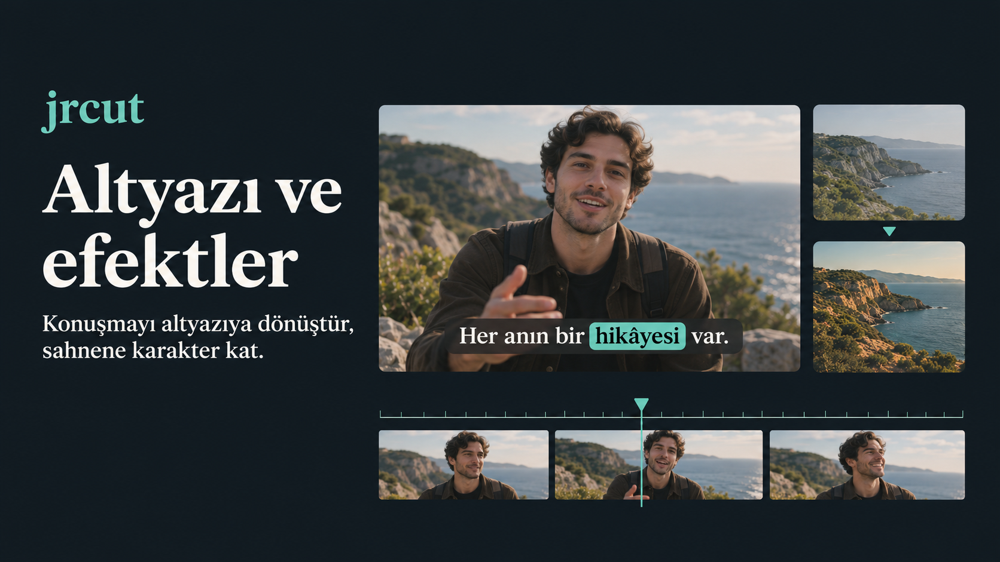
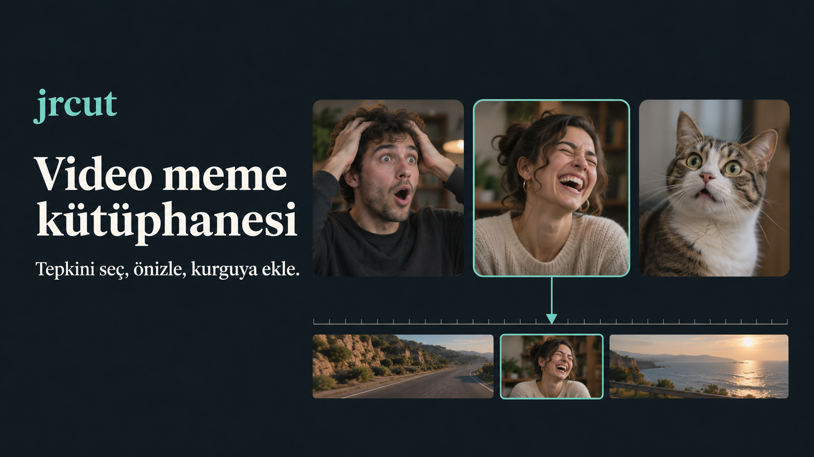

# jrcut

[**⬇ jrcut — Güncel Windows kurucusunu indir**](https://github.com/emrhn034/jrcut-releases/releases/latest/download/jrcut.exe)

[Sürüm sayfası](https://github.com/emrhn034/jrcut-releases/releases/latest)

jrcut, Windows için video düzenleme ve oyun klibi hazırlama uygulamasıdır.

1. Yukarıdaki indirme bağlantısıyla Windows kurucusunu indir.
2. Kurucuyu çalıştır ve **Kur** düğmesine bas. Kurucu, uygulama paketini ve altyazı modelini otomatik indirir. Kurulum sırasında internet bağlantısı gerekir.

## v0.016 — Kamera ve oyun kadrajı düzeltildi

**Kaynak görüntüsünü kırp** ekranında kamera ve oyun alanlarını köşelerinden büyütüp küçült. Oyun seçimi panel oranını korur; serbest yerleşimde sağdaki telefon önizlemesinden iki alanı da doğrudan düzenleyebilirsin. Sayısal boyut ayarları ve tek adımda geri alma da desteklenir.

Kurulu kullanıcılar **Ayarlar → Güncellemeler** bölümünden güncelleyebilir. Üstteki indirme bağlantısı güncel ve eksiksiz Windows kurucusuna gider.

## v0.015 — Sessizlikleri otomatik kaldır

Uzun duraklamaları tek tek kesmek yerine jrcut'a buldur. Zaman çizelgesinde video veya ses klibini seç, **◌ Sessizlik** düğmesine bas ve kesilecek bölümleri incele.

- **Sessiz bölümler:** Ses seviyesi, en kısa boşluk ve korunacak pay ayarlarıyla gereksiz duraklamaları bul.
- **Konuşma algılama:** Konuşma olmayan bölümleri bilgisayarında analiz et; ek hesap veya API anahtarı gerekmez.
- **İncele ve uygula:** Kesilecek alanları dinle, önemli bölümleri koru ve kesilmiş halini önizle.
- **Birlikte düzenleme:** Görüntü, kamera, ses ve altyazılar eşzamanlı kısalır; kaynak dosyan değişmez. Tek adımda geri alabilirsin.

Analiz bilgisayarında yapılır; ses ve videoların analiz için bir sunucuya gönderilmez. En kısa boşluğu ve konuşma uçlarında korunacak payı ayarlayabilir, kesmek istemediğin bölümleri koruyabilirsin.

Kurulu kullanıcılar **Ayarlar → Güncellemeler** bölümünden güncelleyebilir. Yeni kullanıcılar üstteki **güncel Windows kurucusu** bağlantısını kullanabilir.

## jrcut ile neler yapabilirsin?

Video, fotoğraf ve sesi katmanlarla düzenle. Hazır Shorts yerleşimlerinde kamerayı üste veya köşeye al. Yatay, dikey, kare ve gönderi formatlarını kullan.

Ekranı veya pencereyi seç, kamera ve mikrofonunu ekle. Klip tamponu açıkken son anları kaydet. Kick yayın tekrarlarını ve kliplerini de kurguya taşıyabilirsin.

Türkçe ve İngilizce otomatik altyazı oluştur. Metni, zamanlamayı ve görünümü düzenle. Geçişler, efektler, hareketli grafikler ve ses işleme araçlarıyla kurgunu tamamla.

Hazır video memelerini kategoriye göre bul, önizle ve zaman çizelgesine ekle. Sık kullandıklarını favorilerine kaydet.

Projeni kaydet, videonu dışa aktar ve aynı Wi-Fi ağındaki telefonuna QR kodla gönder.

*Görseller, özellikleri temsili örneklerle anlatır.*

## Kullanım lisansı

jrcut'un özgün yazılım hakları geliştiricisine aittir. Kişisel ve ticari video üretiminde kullanımına izin verilir. Yazılımın izinsiz yeniden satışı ve dağıtımı kısıtlıdır. Üçüncü taraf bileşen ve içeriklerin kendi lisansları geçerlidir. [Kullanım lisansını oku](LICENSE.txt).
