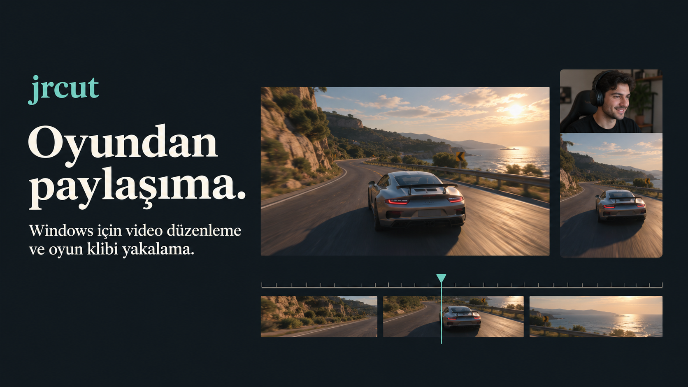
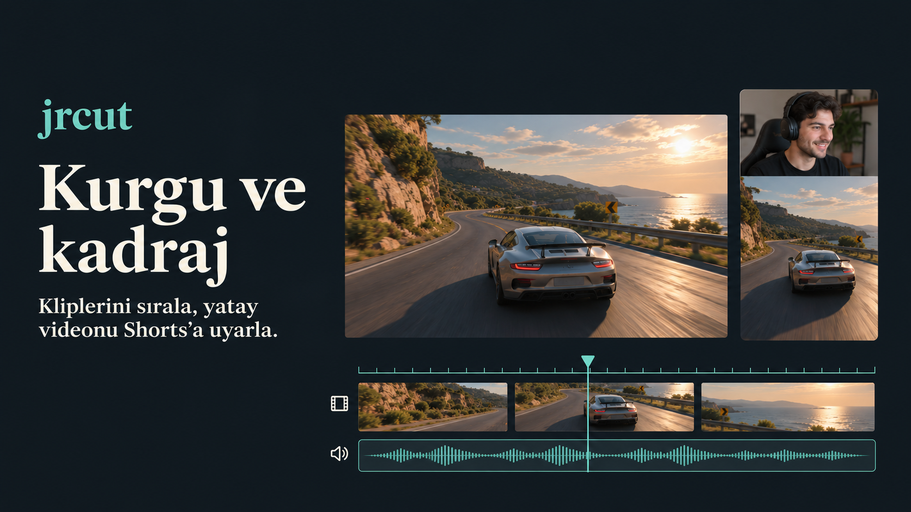
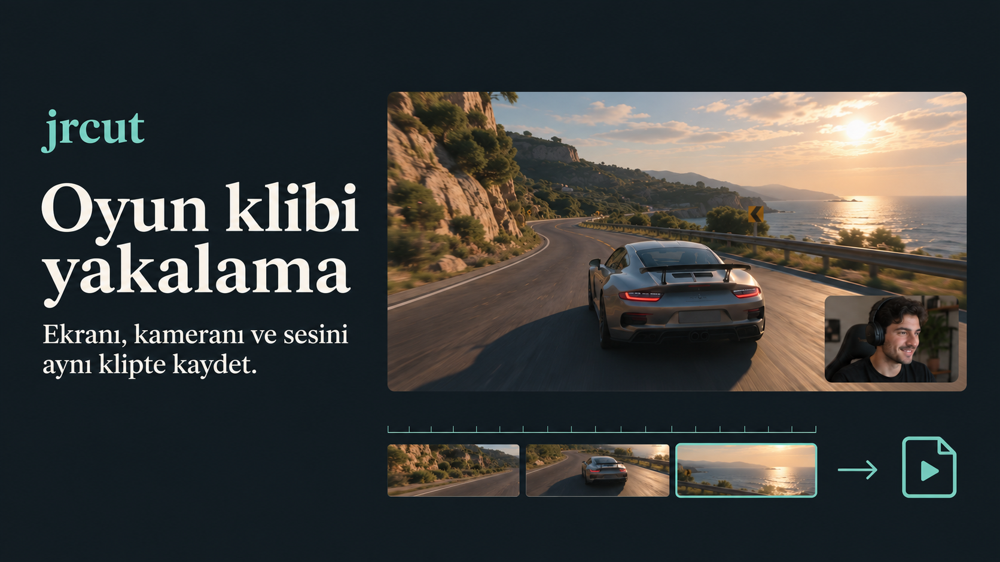
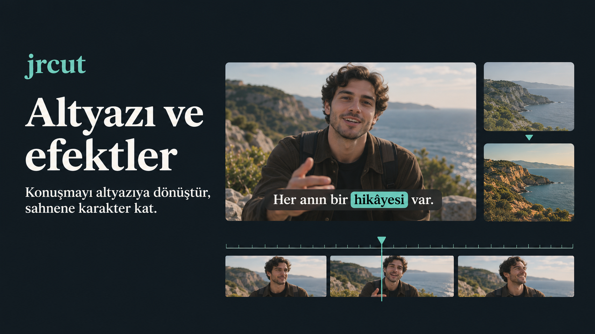

# jrcut

[**⬇ jrcut v0 — Windows kurucusunu indir**](https://github.com/emrhn034/jrcut-releases/releases/download/v0/jrcut-v0-Setup-4-connections.exe)

[Sürüm sayfası](https://github.com/emrhn034/jrcut-releases/releases/tag/v0)

jrcut, Windows için video düzenleme ve oyun klibi hazırlama uygulamasıdır.

1. Yukarıdaki indirme bağlantısıyla Windows kurucusunu indir.
2. Kurucuyu çalıştır ve **Kur** düğmesine bas. Kurucu, uygulama paketini ve altyazı modelini otomatik indirir. Kurulum sırasında internet bağlantısı gerekir.

## jrcut ile neler yapabilirsin?

Video, fotoğraf ve sesi katmanlarla düzenle. Hazır Shorts yerleşimlerinde kamerayı üste veya köşeye al. Yatay, dikey, kare ve gönderi formatlarını kullan.

Ekranı veya pencereyi seç, kamera ve mikrofonunu ekle. Klip tamponu açıkken son anları kaydet. Kick yayın tekrarlarını ve kliplerini de kurguya taşıyabilirsin.

Türkçe ve İngilizce otomatik altyazı oluştur. Metni, zamanlamayı ve görünümü düzenle. Geçişler, efektler, hareketli grafikler ve ses işleme araçlarıyla kurgunu tamamla.

Hazır video memelerini kategoriye göre bul, önizle ve zaman çizelgesine ekle. Sık kullandıklarını favorilerine kaydet.

Projeni kaydet, videonu dışa aktar ve aynı Wi-Fi ağındaki telefonuna QR kodla gönder.

*Görseller, özellikleri temsili örneklerle anlatır.*
