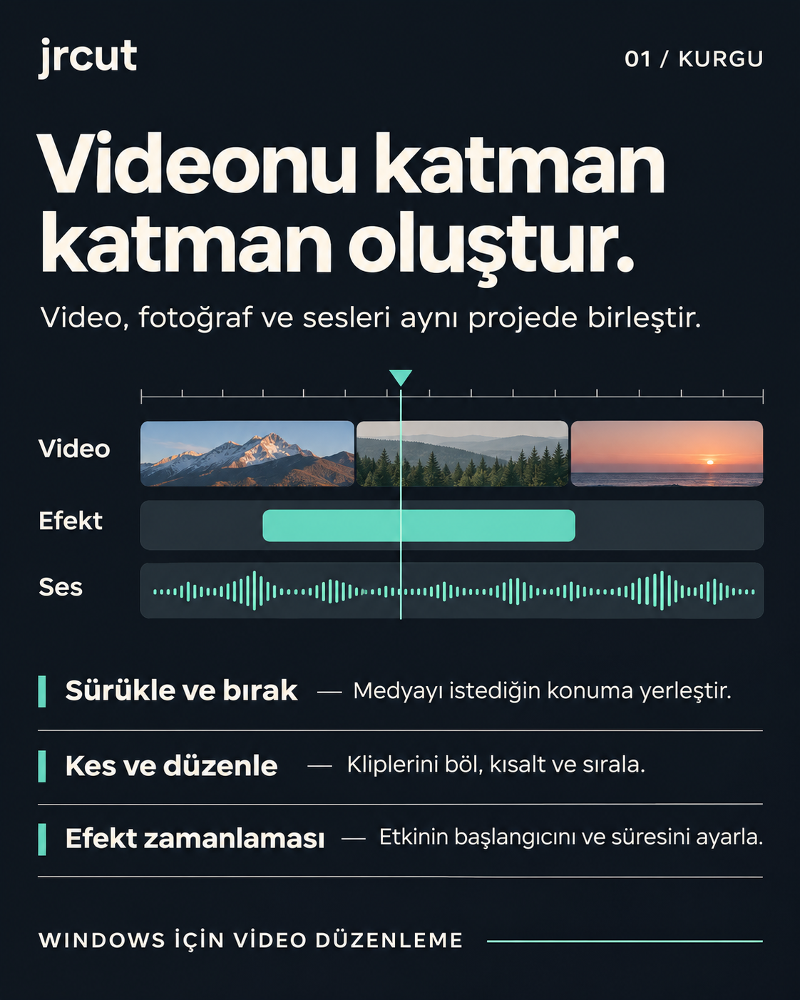
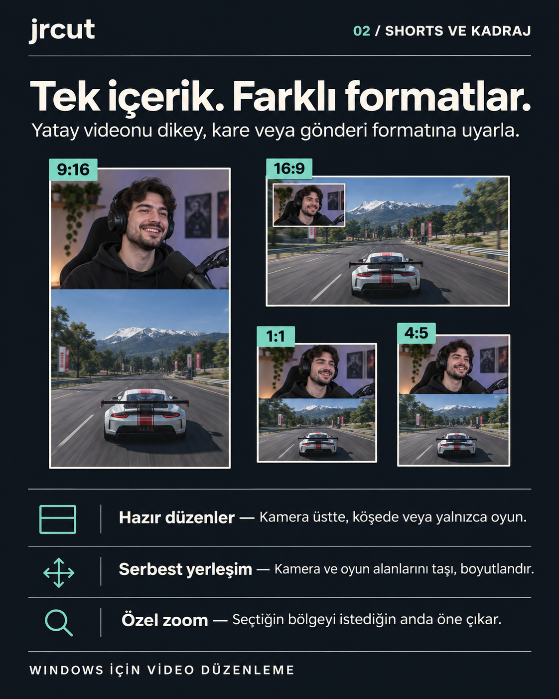
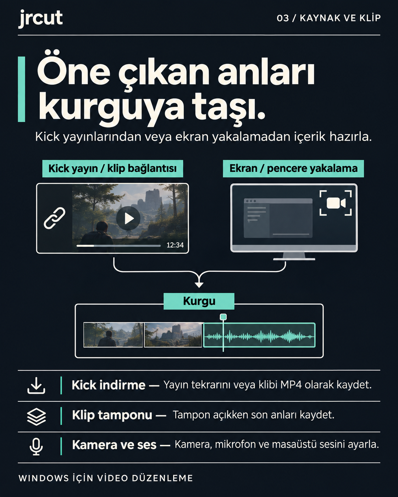
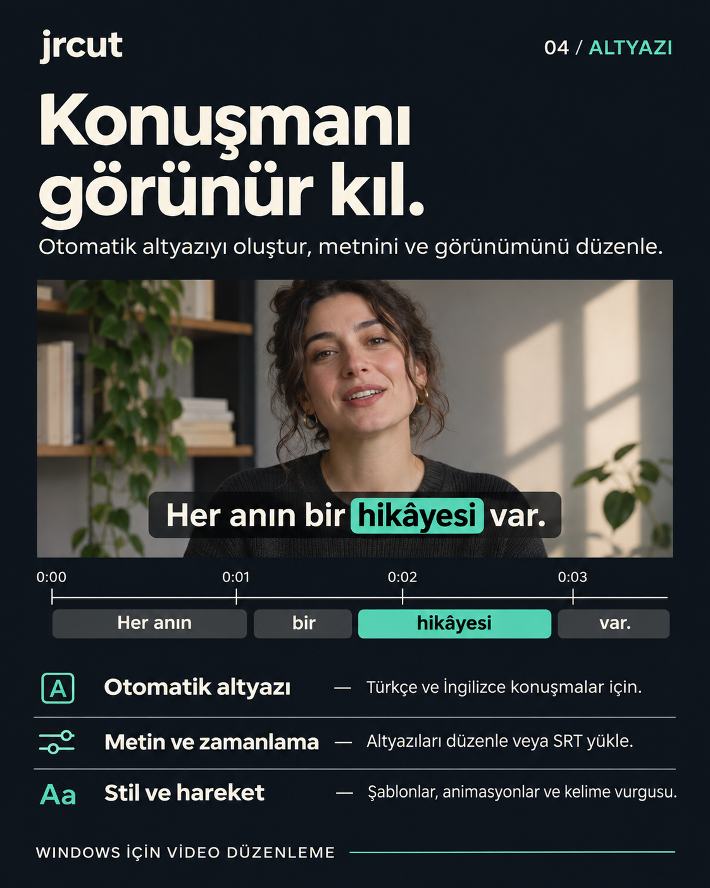
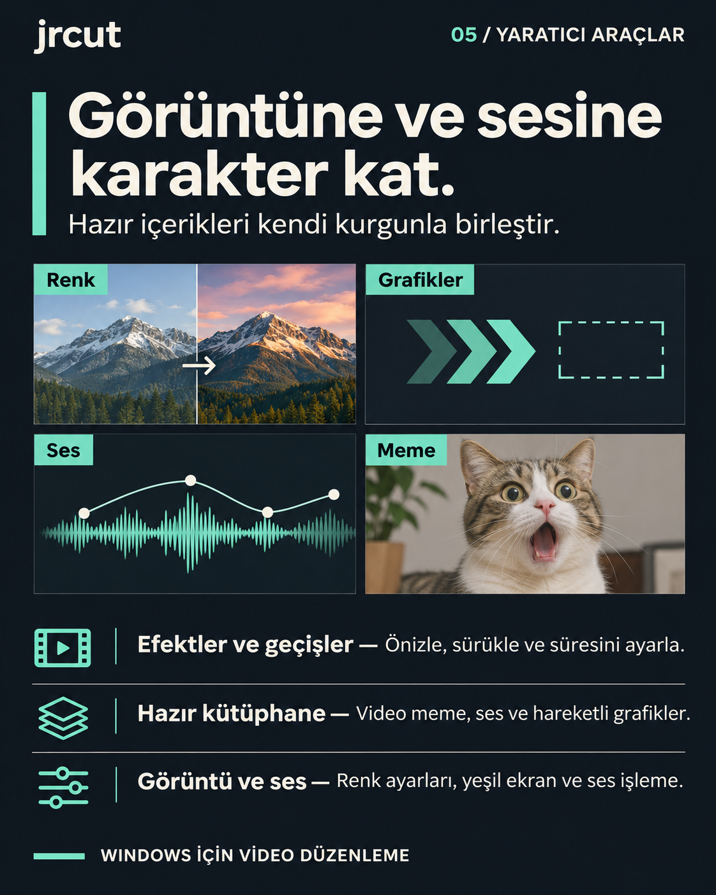
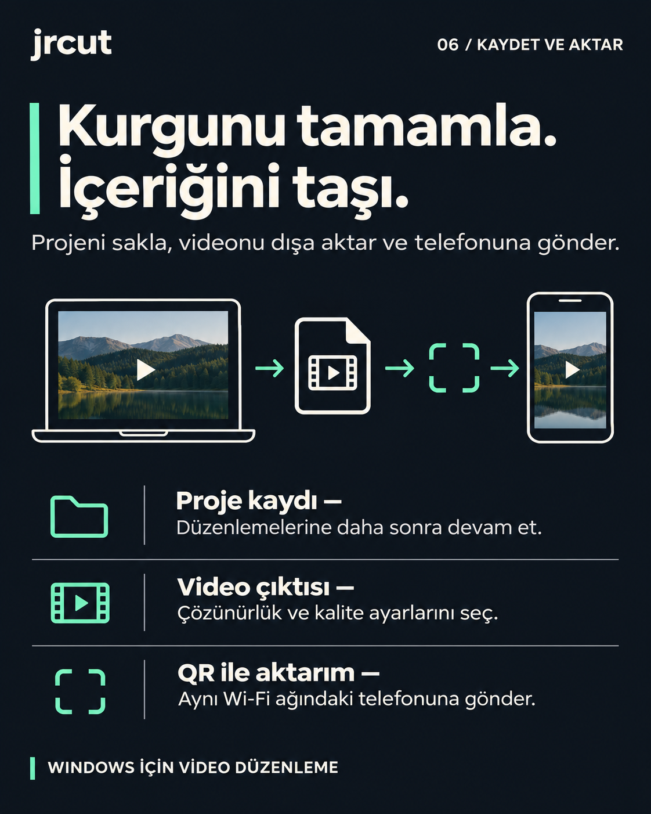
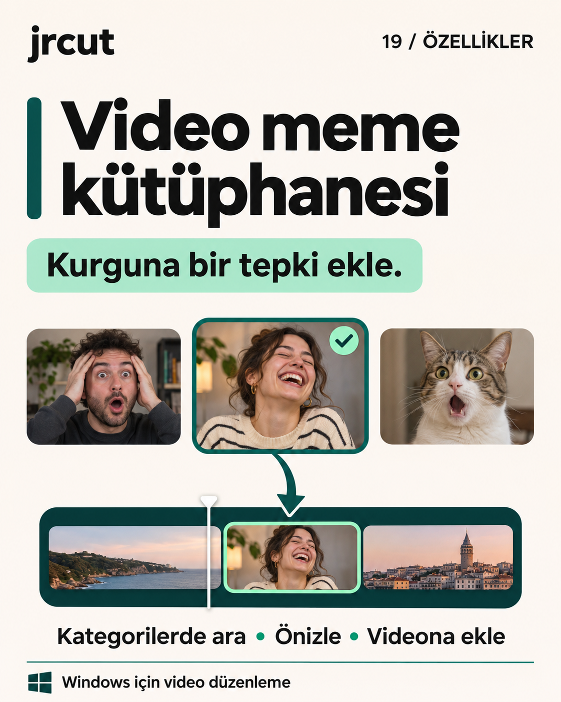

# jrcut

[**⬇ jrcut v0 — Windows kurucusunu indir**](https://github.com/emrhn034/jrcut-releases/releases/download/v0/jrcut-0.2.93-Setup.exe)

[Sürüm sayfası](https://github.com/emrhn034/jrcut-releases/releases/tag/v0)

jrcut, Windows için video düzenleme ve oyun klibi hazırlama uygulamasıdır.

1. Yukarıdaki indirme bağlantısıyla Windows kurucusunu indir.
2. Kurucuyu çalıştır ve **Kur** düğmesine bas. Kurucu, uygulama paketini ve altyazı modelini otomatik indirir. Kurulum sırasında internet bağlantısı gerekir.

## jrcut ile neler yapabilirsin?

| Kurgu | Shorts ve kadraj |
| --- | --- |
|  |  |

| Yayın ve oyun klipleri | Otomatik altyazı |
| --- | --- |
|  |  |

| Yaratıcı araçlar | Dışa aktarma |
| --- | --- |
|  |  |

### Hazır video meme kütüphanesi

Tepki kliplerini kategoriye göre bul, önizle ve zaman çizelgesine ekle. Sık kullandıklarını favorilerine kaydet.

  

*Görseller, özellikleri temsili örneklerle anlatır.*
